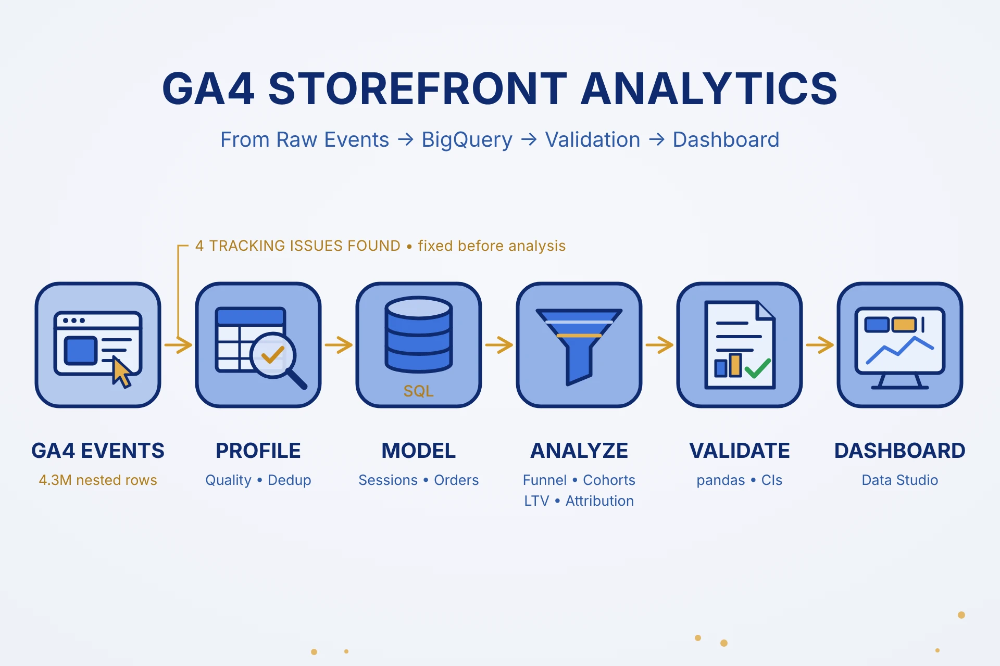
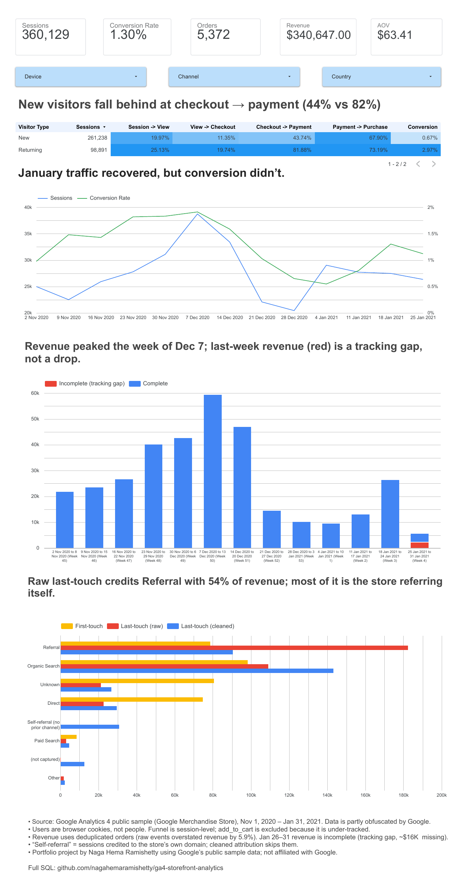

# 🛍️ GA4 Storefront Analytics: Customer Journey, Retention, and Attribution in BigQuery



_Turning 4.3 million raw GA4 events from the Google Merchandise Store into a trustworthy funnel, cohort, lifetime value, and attribution analysis, validated before a single number was reported._

---

## 🧩 Overview

**GA4 Storefront Analytics** is an end-to-end product analytics project built on Google's public GA4 e-commerce export for the Google Merchandise Store (Nov 1, 2020 to Jan 31, 2021). It covers data quality profiling, sessionization, a conversion funnel with segment-level drop-off, weekly cohort retention, observed customer lifetime value, multi-model channel attribution, and week-over-week trends, all in SQL on BigQuery, independently validated in Python, and delivered as an interactive Data Studio dashboard.

The dataset contains 4,295,584 events across 92 daily tables, rolled up into 360,129 sessions and 5,372 deduplicated orders worth $340,647.

---

## 🎯 The Problem

> Which funnel step, device, and channel should the store focus on first to improve conversion, and can the numbers in the default reports even be trusted?

GA4 data looks clean on the surface, but this export hides real problems: double-fired purchase events, an under-tracked funnel step, the store crediting revenue to itself as a "referral," and a stretch of orders recorded with no revenue. This project answers the business question only after measuring and correcting each of those issues, so every downstream number rests on a validated base.

---

## 💡 Motivation

Most GA4 portfolio projects stop at a single funnel query and a chart. This one was built the way a business intelligence team would approach it: start from one stakeholder decision, define every metric with an explicit numerator and denominator, profile the data before trusting it, and attach a confidence interval or caveat to every claim. It was also a deliberate exercise in modern event data, which is nested and repeated rather than flat, and in writing cost-aware SQL inside the free BigQuery sandbox.

---

## 🧬 Core Idea

The project moves from raw nested events to a stakeholder-facing dashboard in six stages:

1. **Profile** the raw export for completeness, event coverage, nested parameter types, duplicates, and obfuscation (SQL `00`–`07`)
2. **Model** two reusable tables, one row per session and one row per deduplicated order, each reconciled to independent counts (SQL `10`, `11`, `21`, `22`)
3. **Analyze** five business questions: funnel, retention, lifetime value, attribution, and trends (SQL `12`–`30`)
4. **Validate** every headline number independently in pandas and add confidence intervals (notebook)
5. **Publish** count-only summary tables to Google Sheets so the dashboard computes correctly weighted rates for any filter (SQL `31`–`33`)
6. **Visualize** the results in an interactive Data Studio dashboard with device, channel, and country filters

---

## 🧠 Why It Matters

- Demonstrates advanced BigQuery SQL on nested GA4 data: `UNNEST` on repeated fields, CTEs, framed window functions, `LAST_VALUE ... IGNORE NULLS`, `ARRAY_AGG` with `STRUCT`, `ROLLUP`, and scripting with `DECLARE`.
- Treats data quality as part of the analysis rather than a preamble: four tracking issues were found, quantified in dollars, and corrected before any business conclusion was drawn.
- Every number is reconciled twice, once against an independent SQL count and once in a separate pandas recomputation, including the trickiest attribution logic.
- Uses statistics to stop overclaiming: a bootstrap confidence interval showed one apparent channel advantage was not significant, and the conclusion was changed accordingly.

---

## 🧰 Tools and Technologies

| Category                  | Stack                                                        |
| ------------------------- | ------------------------------------------------------------ |
| **Data Warehouse**        | Google BigQuery (free sandbox)                               |
| **Query Language**        | Standard SQL (BigQuery dialect)                              |
| **Validation & Stats**    | Python, pandas, NumPy                                        |
| **Visualization**         | matplotlib                                                   |
| **Business Intelligence** | Data Studio (formerly Looker Studio), Google Sheets          |
| **Notebook Environment**  | JupyterLab                                                   |
| **Version Control**       | Git, GitHub                                                  |

---

## 🧩 Methodology

### Phase 1. Data Quality Profiling

Confirmed all 92 daily tables exist, inventoried all 17 event types, and profiled the 29 keys inside the nested `event_params` field. Found that `view_item_list` was barely tracked (71 events against 1.35M page views), that some numeric parameters are stored in mixed types, and that 21% of channel values are obfuscated. Purchase events were checked for duplicate and missing transaction IDs: 95% of duplicated IDs were the same user and amount a median of 36 milliseconds apart, a double-fired tag. Deduplicating on transaction ID plus user removed $21,518 (5.9%) of overstated revenue.

### Phase 2. Data Modeling

Built a sessions table keyed on `user_pseudo_id` + `ga_session_id`, with device, country group, visitor type, first-touch and session-level channel, and funnel flags. It reconciles exactly to the 354,970 `session_start` events. Built an orders table applying the deduplication rule, reconciling to 5,372 orders, $340,647, and 4,419 buyers, with 100% of orders joined back to their session. Tables use clustering rather than partitioning, because sandbox partition expiry silently deleted every 2020 partition on the first attempt, an issue caught by the validation query.

### Phase 3. Business Analysis

| Question | Approach | SQL |
| -------- | -------- | --- |
| Where do shoppers drop off? | Closed session funnel; diagnosed `add_to_cart` as under-tracked with a window function over each user's prior sessions; segment comparison; deferred vs lost demand check; scenario sizing | `12`–`18` |
| Do customers come back? | Weekly cohorts of truly new users with left- and right-censoring; pooled retention for buyers vs browsers | `19`, `20` |
| What is a customer worth? | Observed (not predicted) LTV with per-user horizon eligibility; LTV by acquisition channel | `23`, `24` |
| Which channels drive purchases? | First-touch, last-touch, and last-non-direct models; traced inflated referral revenue to the store's own domain; rebuilt attribution with self-referrals skipped | `25`–`27` |
| How did performance change? | Weekly KPIs decomposed into sessions × conversion × AOV with `LAG`; daily drill-down that located a revenue tracking gap | `28`–`30` |

### Phase 4. Validation in Python

Recomputed 11 headline numbers in pandas, all matching the SQL exactly. Rebuilt the attribution carry-forward logic with `groupby` + `ffill`, matching to the decimal. Added a normal-approximation confidence interval for the new vs returning conversion gap and a 2,000-resample bootstrap for the difference in channel LTV.

### Phase 5. Dashboard

Exported three count-only summary tables to Google Sheets so the dashboard never averages pre-computed rates, then built a one-page Data Studio report: KPI scorecards, a funnel heatmap by visitor type, a weekly sessions and conversion trend, weekly revenue with the tracking gap flagged, and an attribution comparison, all filterable by device, channel, and country.

---

## 🔍 Key Findings

| Finding | Evidence |
| ------- | -------- |
| Raw purchase events overstate revenue | Double-fired tags added $21,518 (5.9%); official revenue after deduplication is $340,647 |
| `add_to_cart` is under-tracked | Missing in 41% of purchasing sessions; at least 77% of those are the tag not firing (665 were first-ever visits) |
| New visitors fall furthest behind at checkout → payment | 43.7% vs 81.9% for returning visitors; new visitors are 72.5% of sessions but 37% of purchases |
| That lost demand doesn't come back | 98.5% of new visitors who abandon checkout never purchase in a later session |
| Device and country are not the differentiator | Conversion ranges only 1.25–1.35% across devices and 1.28–1.43% across country groups |
| Customers rarely return | Week-1 retention of 2.4–5.7%; first-week buyers return about 6× more often by week 8 (1.9% vs 0.3%) |
| Most customer value arrives on day one | A new user is worth about $1.50 over 60 days; 49% on day 0, 95% within 30 days |
| Default attribution is badly distorted | 60% of last-touch "Referral" revenue ($109,819) is the store referring itself; after cleaning, Organic Search is #1 under every model (29–45%) |
| Apparent channel value differences are not significant | Paid vs Organic 30-day LTV +$0.17, 95% bootstrap CI −$0.26 to +$0.64 |
| Revenue follows conversion, not traffic | Between the Dec 7 peak and the week of Jan 4, sessions fell 25% but revenue fell 84% |
| The final week's revenue is a tracking gap | $0 orders jump from ~4% to 60–100% from Jan 26; about $16K of revenue missing |

---

## 🎨 Dashboard

**Live dashboard:** [GA4 Storefront: Funnel & Revenue Dashboard](https://datastudio.google.com/reporting/6deef37f-62c3-4ca2-bd4e-3f422d52f974)



A PDF snapshot is also included in [`docs/`](docs/). Supporting charts from the validation notebook: [`01_funnel.png`](images/01_funnel.png), [`02_new_vs_returning.png`](images/02_new_vs_returning.png), [`03_weekly_trends.png`](images/03_weekly_trends.png), [`04_attribution.png`](images/04_attribution.png)

Metric definitions, numerators, and denominators are documented in [`docs/metric_dictionary.md`](docs/metric_dictionary.md), and every result is traced to its query in [`docs/findings_log.md`](docs/findings_log.md).

---

## 🧠 Architectural Decisions and Tradeoffs

- **Profiling before analysis**: eight queries were spent validating the data before any business question was answered. Each issue found changed a downstream definition, the funnel steps, the revenue rule, or the channel mapping, which would otherwise have produced confident but wrong conclusions.
- **Reusable session and order tables instead of querying raw events every time**: the raw events were scanned once (about 1.6 GB), and every later query read the small modeled tables, keeping the whole project far inside the free 1 TB monthly limit and guaranteeing one definition of a session everywhere.
- **Counts, not rates, in the dashboard sources**: storing numerators and denominators lets Data Studio compute correctly weighted rates for any filter combination, instead of averaging pre-computed rates.
- **Google Sheets as the dashboard source rather than live BigQuery tables**: sandbox tables expire after 60 days, so the dashboard reads small exported summaries that don't expire, while the SQL that produced them stays in the repo for full reproducibility.
- **Observed rather than predicted lifetime value**: with only 92 days of data, a projected lifetime would be guesswork, so LTV is reported at fixed horizons and only for users who had the full window.

---

## ⚠️ Limitations and Future Directions

- The dataset is an obfuscated sample, and 21% of channel values are unknown, so channel-level results carry more uncertainty than funnel-level results.
- Users are browser cookies, not people. Cross-device journeys appear as separate users, so retention is somewhat understated.
- The window covers only 92 days, including the holiday peak, so seasonal effects and baselines can't be fully separated, and results should not be annualized.
- The analysis identifies where shoppers drop off, not why. A natural next step is an A/B test on the checkout → payment step for new visitors (for example, guest checkout or earlier shipping-cost display).
- No cost data is available, so channel value can be compared but channel ROI cannot be calculated.

---

## 🛠️ How to Run

```bash
# 1. Clone the repository
git clone https://github.com/nagahemaramishetty/ga4-storefront-analytics.git
cd ga4-storefront-analytics

# 2. Install Python dependencies
pip install -r requirements.txt

# 3. Authenticate to BigQuery (requires the gcloud CLI)
gcloud auth application-default login

# 4. Open the validation notebook
jupyter lab notebooks/01_validation_and_charts.ipynb
```

To rebuild the BigQuery tables, create a project with the BigQuery sandbox (no billing required) and a dataset in the US location, replace `ga4-storefront-analytics.p3_storefront` in the SQL files with your own project and dataset, then run `sql/10_build_sessions.sql` and `sql/21_build_orders.sql` before the remaining queries in numeric order.

---

## 👩‍💻 Author

**Naga Hema Ramishetty**
Data Analyst
**GitHub:** [github.com/nagahemaramishetty](https://github.com/nagahemaramishetty)

---

## 🧭 Keywords

`SQL` · `BigQuery` · `GA4` · `Product-Analytics` · `Funnel-Analysis` · `Cohort-Retention` · `Customer-Lifetime-Value` · `Marketing-Attribution` · `Data-Quality` · `Python` · `pandas` · `Data-Studio` · `Business-Intelligence` · `Data-Analyst-Portfolio`

---

## 📚 Dataset Source

[Google Analytics 4 obfuscated sample e-commerce dataset](https://developers.google.com/analytics/bigquery/web-ecommerce-demo-dataset) (`bigquery-public-data.ga4_obfuscated_sample_ecommerce`), published by Google. The data profiling, modeling, analysis, validation, and dashboard in this repository are original work. This project is not affiliated with Google.

---

_This repository demonstrates that a trustworthy product analysis starts with distrusting the data: every number here was profiled, corrected, reconciled, and validated before it was reported._
